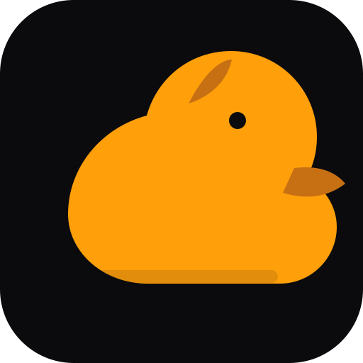

<p align="center"></p>
<h1 align="center">NUNLauncher</h1>
<p align="center"><strong>Kernel Bootstrap Supervisor</strong></p>
<p align="center"></p>
<p align="center"><a href="README.md">🇺🇦 Українська</a> · <a href="README.en.md">🇬🇧 English</a> · <a href="README.ru.md">🇷🇺 Русский</a></p>
<sub>Оновлено: 2026-11-12</sub>


## Поточні можливості
- Host-side validator 48-byte kernel-image header.
- Перевірка architecture, entry offset і меж завантаження в caller-provided memory map.
- Portable CMake build, host tests та GCC/Clang CI.
- Versioned boot-information contract і capability-gate design.
- Окремі readiness gates для emulator та hardware handoff.

## Швидкий старт і перевірка
```bash
cmake -S . -B build
cmake --build build --config Release
ctest --test-dir build --output-on-failure
python one.py check
make test
```

Для перевірки зібраного NUN ISO використайте `make verify IMAGE=../NUN/build/NUN.iso MANIFEST=../NUN/build/NUN.image.json`.

## Архітектура, межі та достовірність
NUNLauncher — host-side шар допуску образу перед запуском: він перевіряє зібраний NUN ISO, але не замінює firmware або Limine, не передає керування ядру й не виконує код образу. CI окремо перевіряє той самий образ у QEMU через BIOS та x86_64 UEFI. Host preflight сам по собі не доводить сумісність довільного фізичного пристрою.

Secure Boot, підпис видавця, ротація ключів та TPM attestation не реалізовані. Поточний manifest явно позначає образ як unsigned; SHA-256 підтверджує збіг із manifest, а не особу видавця.

## Перевірка образу на host

`tools/validate_boot_image.py` перевіряє JSON-manifest, SHA-256, безпечний шлях до образу, межі пам’яті та вирівнювання entry point. Це перевірка метаданих, а не bootloader і не підтвердження підтримки архітектури.

```sh
python tools/validate_boot_image.py path/to/kernel.manifest.json --target x86_64
python -m unittest discover -s tests -p 'test_*.py' -v
```

Validator не завантажує й не виконує код. Перевірка підпису та кваліфікація на фізичному обладнанні залишаються окремими етапами.

## NUN boot-image supervisor

Команда `make verify IMAGE=../NUN/build/NUN.iso MANIFEST=../NUN/build/NUN.image.json` запускає повний pre-handoff ланцюжок: manifest/schema, ім’я й розмір ISO, SHA-256, BIOS/UEFI El Torito entries, ELF64 x86_64 kernel та AMD64 EFI fallback loader. Перевірка виконується в режимі читання; запис на диск і передача керування ядру не виконуються.

`make test` запускає host-тести supervisor. CI будує NUN із закріпленого commit і перевіряє той самий ISO у QEMU через BIOS та x86_64 UEFI. Це підтверджує початковий boot path у цих емуляторних профілях, а не повну готовність ОС чи фізичну апаратну кваліфікацію.

Окремий `verify-e2k` перевіряє структуру E2K Linux userspace ELF (`EM_MCST_ELBRUS=175`) і manifest. Це не bare-metal E2K bootloader/kernel. Нативний запуск можливий лише в окремому ручному workflow на self-hosted E2K runner.

<p align="center"></p>

## Карта документації

- [Контракт образу ядра](docs/BOOT_IMAGE_CONTRACT.md)
- [Boot-image supervisor та модель довіри](docs/BOOT_SUPERVISOR.md)
- [E2K Linux userspace admission](docs/E2K_RUNTIME.md)
- [Інтеграція екосистеми](docs/ECOSYSTEM_INTEGRATION.md)
- [Інженерне врядування](docs/ENGINEERING_GOVERNANCE.md)

## Ліцензія
Ліцензію не оголошено; файл LICENSE відсутній.

---

## Статус інтеграцій

- Репозиторій зберігає власні API, збірку, тести та цикл випуску; міжпроєктна взаємодія відбувається через явні версіоновані контракти.
- STaas (SaaS integration control plane) і MoonTreach (CI/test acceleration) розвиваються окремими Pull Requests. Їх не слід вважати можливостями `main` або production-ready до злиття та проходження обов'язкових перевірок.
- Правила федерації та інтеграції: [Hellduck Integration Playbook](https://github.com/bboroski/Hellduck/blob/main/docs/INTEGRATION_PLAYBOOK.md).

## Інженерний стандарт
Індекс аудиту, тестових воріт, безпеки, супроводу та критеріїв інтеграції: [Engineering Improvement Index](docs/ENGINEERING_IMPROVEMENT_INDEX.md).

## Інтеграційні межі
Зберігайте незалежні API, runtime та цикли випуску; інтегруйте через версіоновані контракти. [Hellduck Integration Playbook](https://github.com/bboroski/Hellduck/blob/main/docs/INTEGRATION_PLAYBOOK.md).

---
**「在天愿作比翼鸟，在地愿为连理枝。」**

*«У небі — птахами-нерозлучниками, на землі — гілками одного дерева».*
