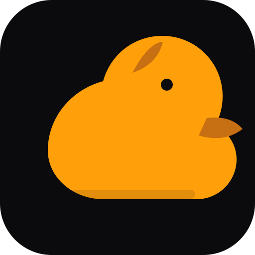

<h1 align="center">NUNLauncher</h1>

<strong>Android HOME Launcher · проектирование загрузочной цепочки NUN</strong>

<a href="README.md">🇺🇦 Українська</a> · <a href="README.en.md">🇬🇧 English</a> · <a href="README.ru.md">🇷🇺 Русский</a>

<a href="design/DUCK_UI_SYSTEM.md">Duck Black / Yellow UI standard</a> · <a href="assets/duck-ui/duck-ui-preview.svg">Vector UI preview</a>

**NUNLauncher — Android HOME-приложение экосистемы NUN.** Оно предоставляет домашний экран, обнаруживает видимые приложения, запускает их и сохраняет избранное. Будущий firmware boot supervisor — отдельная цель сборки, а не Android activity.

## Реализованный стартовый слой

- Android application module на Kotlin с application ID org.nun.launcher.
- MAIN + HOME + DEFAULT intent filter для роли домашнего экрана Android.
- Отдельный MAIN + LAUNCHER filter для запуска NUNLauncher как обычного приложения.
- Обнаружение доступных launchable activities через LauncherApps и видимые Android-профили.
- Локальный поиск, сетка приложений, запуск программ и избранное (долгое нажатие).
- Чёрно-жёлтая Duck UI палитра, векторная adaptive icon и строки на украинском, английском и русском.
- CI workflow для сборки debug APK.

## Граница ответственности

Android HOME — обычное приложение под управлением Android. Оно не заменяет Android kernel, firmware, recovery, системный образ или bootloader. Пользователь выбирает NUNLauncher как HOME через Android Settings. Связь с ядром NUN не имитируется: интерфейс явно показывает, что ядро не подключено.

## Сборка

Требуются JDK 17, Android SDK Platform 36 и Gradle 9.6.0. Команда: <code>gradle :app:assembleDebug</code>.

Ожидаемый путь к APK: <code>app/build/outputs/apk/debug/app-debug.apk</code>. Существование файла не заявляется, пока сборка не выполнена и артефакт не проверен.

## Первый запуск

1. Собрать и установить debug APK на Android 8.0 или новее.
2. Открыть Settings → Apps → Default apps → Home app (названия пунктов зависят от производителя).
3. Выбрать NUNLauncher.
4. Нажать Home и проверить результат системного резолвера.

## Планируемые возможности

Dock, папки, виджеты, shortcuts, gestures, notification dots, управление обоями, accessibility settings, локальная панель NUN device dashboard и синхронизация сессий планируются отдельно. Каждая функция должна использовать публичные Android API, минимальные разрешения, версионированное хранилище и явное offline-состояние.

## Отдельная firmware boot chain

Спецификация будущего загрузчика NUN находится отдельно в [NUN_BOOT_CHAIN.md](docs/NUN_BOOT_CHAIN.md). Наличие Android HOME-кода не означает наличие UEFI loader, bootable image или проверенной архитектуры. Ядро NUN будет самостоятельно проверять handoff-контекст.

## Документация

- [Android HOME Launcher](docs/ANDROID_HOME_LAUNCHER.md)
- [Разделение загрузочной цепочки NUN](docs/NUN_BOOT_CHAIN.md)
- [Основа ОС в NUN](https://github.com/bboroski/NUN/blob/main/docs/OS_FOUNDATION.md)

## Лицензия

В NUNLauncher отсутствует файл LICENSE, лицензия не объявлена. До публичного распространения необходимо определить условия использования.

---

**NUNLauncher — создано с любовью к простым, быстрым и понятным интерфейсам.**
